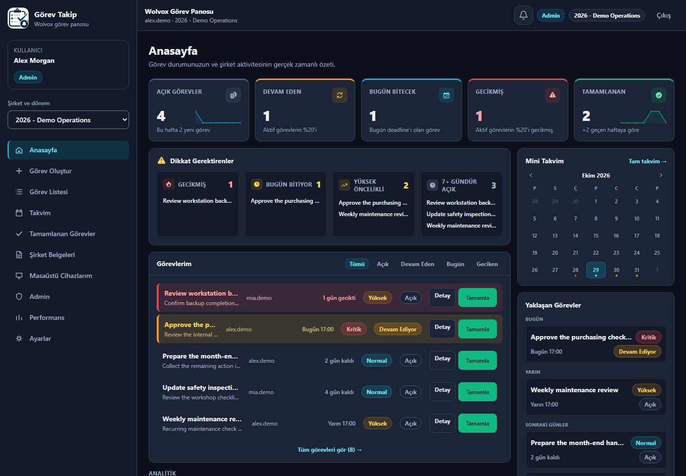
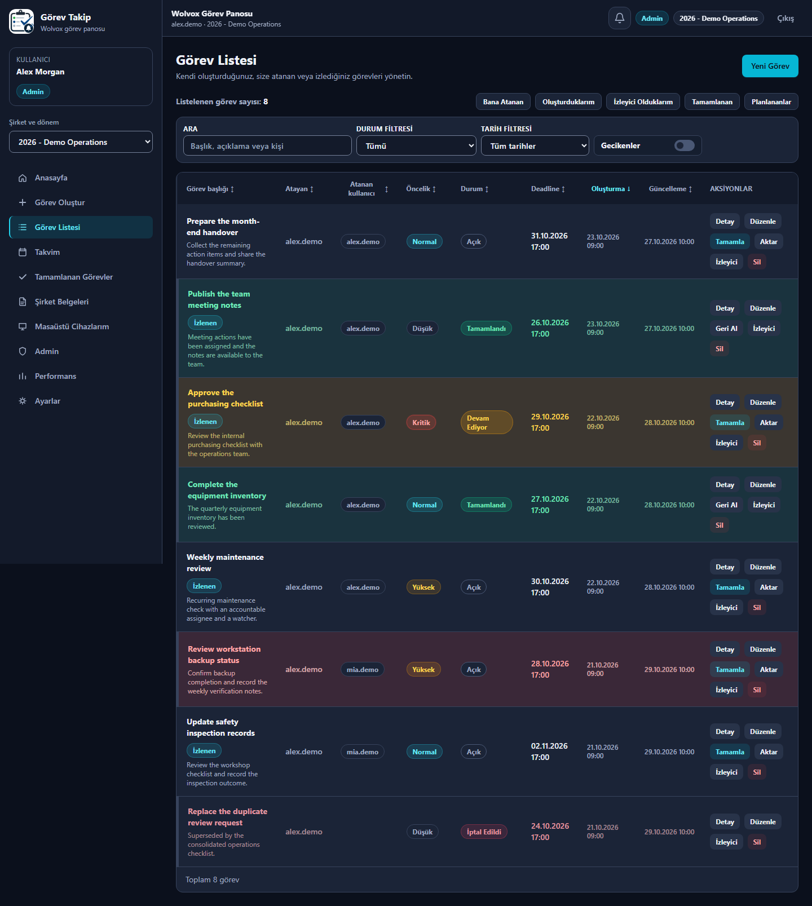
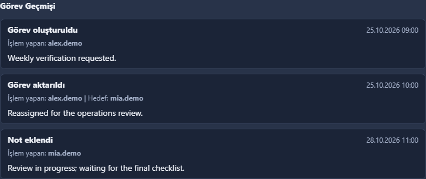
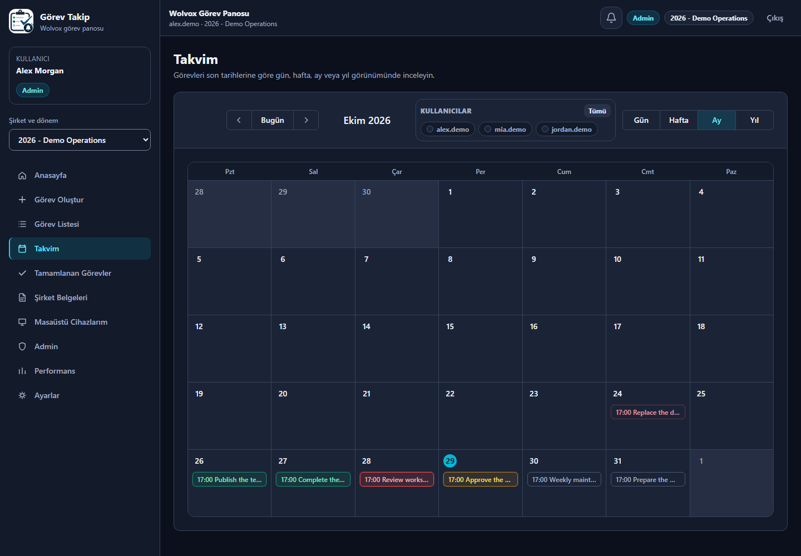
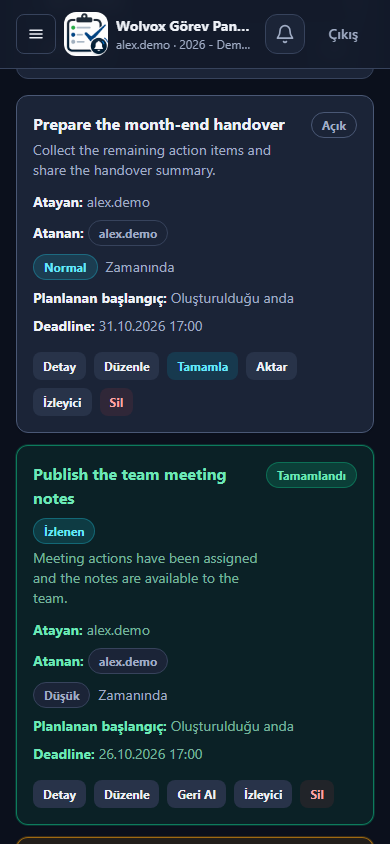

# Görev Takip

### ERP-integrated task coordination for on-premises teams

Görev Takip connects day-to-day work with the company and user context of an existing Wolvox ERP environment. A responsive web workspace brings assignments, deadlines, recurring work and task history together, with a Windows desktop companion for reminders.

**C# / .NET 10 · ASP.NET Core · React 19 · TypeScript · Firebird · Microsoft SQL Server**

> Documentation-only showcase. The images show the actual React interface rendered with synthetic API fixtures. Names, companies, tasks and metrics are fabricated for presentation. They are not customer records, production screenshots or proof of a live deployment. The application's Turkish interface is preserved.

## Business Problem

Operational work often spans an ERP system, informal messages and individual reminders. Teams need a clear answer to who owns a task, when it is due, what changed and whether follow-up is still required. Introducing another tool should not require moving the existing ERP database or losing company-specific access boundaries.

## Solution

Görev Takip adds a task-oriented workspace alongside the existing ERP environment. Users work within a selected company and period, while server-side rules determine which records and actions they may access. The application manages its own task data without treating ERP business tables as general-purpose task storage.

## Main Capabilities

| Area | Implemented scope |
| --- | --- |
| Task lifecycle | Create, inspect, edit, complete, reopen, cancel and transfer tasks; optional retention of the previous assignee during transfer. |
| Responsibility and visibility | Separate assignees and watchers, creator management and administrative views, with API-side authorization. |
| Planning | Deadlines, optional planned starts, recurring work and calendar views for day, week and month. |
| Operational visibility | Dashboard summaries, overdue indicators, priority/status badges, filtering, sortable task tables and personnel summaries. |
| Collaboration | Task notes, chronological event history, attachments and company document management. |
| Reminders | In-app reminders and a paired Windows desktop companion; mobile reminders use a compact grouped presentation. |
| Identity and administration | ERP-aware users, application-owned accounts, MFA flows and scoped administrative actions. |

These are implemented application capabilities, not a claim that every deployment combination has completed customer acceptance.

## Application Preview

### Task workspace

Filtering, responsibility, due dates and row-level actions remain visible in the operational table. Completed and overdue work have distinct visual states.

### Task history

The task detail dialog retains a chronological record of changes and notes. This capture focuses on its history section.

### Calendar planning

The calendar provides an alternative entry point to the same task workflow rather than a separate task system.

### Mobile workspace

The mobile layout presents task information as cards while retaining filters and authorized actions.

## Technology Stack

| Layer | Technologies used |
| --- | --- |
| Backend | C#, .NET 10, ASP.NET Core, ADO.NET/provider-specific SQL access |
| Frontend | React 19, TypeScript, Vite, Tailwind CSS, React Router |
| State and forms | TanStack Query, React Hook Form, Zod |
| Databases and integration | Firebird and Microsoft SQL Server providers; Wolvox ERP integration |
| Windows components | Windows Service hosting, native setup tooling and a desktop reminder companion |
| Testing | xUnit, integration/security fixtures, Playwright, Chromium and WebKit checks |
| Development quality | ESLint, Prettier and controlled build/release verification |

## High-Level Architecture

- **Web client:** task screens, forms, dashboards and responsive calendar views. Query state is scoped to the selected user and company.
- **ASP.NET Core application:** authenticates requests, applies company/task authorization, coordinates task workflows and handles protected file access.
- **Database providers:** adapt access to the existing Firebird or SQL Server environment and application-owned task storage.
- **Windows companion:** communicates with the application for paired desktop reminders without putting database credentials on client PCs.
- **Setup and maintenance:** separate server/client distribution paths and controlled installation, upgrade and recovery workflows.

This intentionally omits private schemas, queries, endpoints, infrastructure addresses and deployment configuration.

## Engineering Challenges

### Preserving the ERP boundary

The application must fit an existing business environment, not replace it. Company/period context and ERP identities have to coexist with application-owned records and account flows. Read-only historical periods and explicit integration boundaries are part of that design.

### Keeping authorization consistent across views

Task lists, calendar panels, file access and administrative screens must agree on who can see or change a record. Frontend controls guide the user, but the API remains the authority; a hidden button is not an access-control mechanism.

### Maintaining workflow history through reassignment

Completion, reopening, transfer, watchers and recurrence interact with visibility and reminders. The implementation retains task context and history rather than creating disconnected experiences for each screen.

### Treating installation as part of the product

On-premises delivery includes service identity, protected configuration, certificate validation, database compatibility, upgrade integrity and recovery. A successful build is not treated as evidence of a successful customer installation.

## Development Status

**Release-candidate engineering; production deployment approval pending.**

Project records identify a release candidate with local synthetic Windows installation/upgrade acceptance and automated regression evidence. This portfolio preparation did not rerun that complete release suite. It separately built the frontend into a temporary preview and captured the images above with Playwright.

Target-server validation, customer-environment acceptance, trusted SQL Server TLS verification where applicable, independent security review and signing remain separate release gates. No production-readiness, customer-adoption, performance or security-certification claim is made here.

## Privacy and Source Code

Application source code is not included in this public repository. Source access is private. Customer configuration, business records, database exports, SQL/schema definitions, credentials, private keys, internal release reports and installation packages are excluded from this showcase.

See [NOTICE.md](NOTICE.md) for the presentation and confidentiality boundary.

## Developer

**Berke Kırşallıoba**

Full-Stack .NET Developer

[GitHub](https://github.com/berkekirsallioba) · [LinkedIn](https://www.linkedin.com/in/berkekirsallioba)
